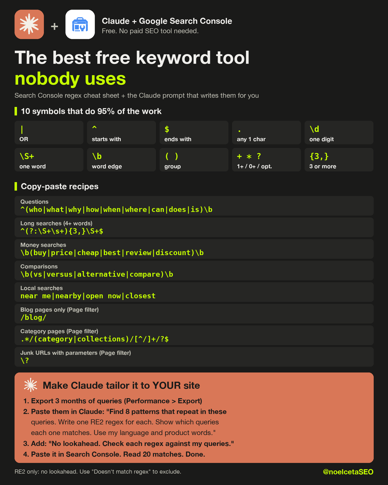

# Search Console regex cheat sheet

Search Console + Claude is the best free keyword tool nobody uses.

Search Console has a regex filter that shows every search matching a pattern, with clicks, impressions and position. Most people skip it because regex looks scary. This repo gives you copy-paste filters, and the Claude prompts that write new ones for your own site.



- [Where it goes](#where-it-goes)
- [The 10 symbols](#the-10-symbols-that-do-95-of-the-work)
- [Query recipes](#query-recipes)
- [Page recipes](#page-recipes)
- [What to do with each](#what-to-do-with-each)
- [Make Claude tailor it to your site](PROMPTS.md)
- [Mistakes](#mistakes)

## Where it goes

Search Console > Performance > Search results > Add filter > Query (or Page) > Custom (regex).

- **Matches regex** = show only these
- **Doesn't match regex** = hide these

Search Console uses RE2. No lookahead, no lookbehind. Max 4,096 characters.

## The 10 symbols that do 95% of the work

| Symbol | Means | Example |
|---|---|---|
| `\|` | OR | `buy\|price\|cheap` |
| `^` | starts with | `^how` |
| `$` | ends with | `review$` |
| `.` | any one character | `iphone.15` |
| `.*` | anything, any length | `/blog/.*` |
| `\d` | one digit | `\d{4}` = 4 digits |
| `\S+` | one word | `^\S+$` = single-word searches |
| `\s` | a space | `near\sme` |
| `\b` | word edge | `\bbuy\b` skips "buyer" |
| `( )` | group | `^(who\|what\|why)\b` |

Counts: `+` one or more, `*` zero or more, `?` optional, `{3,}` three or more.

Page URLs are case-sensitive. Put `(?i)` first to ignore case: `(?i)/blog/`.

## Query recipes

| What it finds | Regex |
|---|---|
| Questions | `^(who\|what\|why\|how\|when\|where\|which\|can\|does\|is\|are\|do\|should)\b` |
| Long searches (4+ words) | `^(?:\S+\s+){3,}\S+$` |
| One-word searches | `^\S+$` |
| Money searches | `\b(buy\|price\|cheap\|best\|review\|discount\|coupon\|offer)\b` |
| Comparisons | `\b(vs\|versus\|alternative\|alternatives\|compare)\b` |
| Year searches | `\b20\d{2}\b` |
| Local searches | `near me\|nearby\|open now\|closest` |
| Model codes (UE55, RB34...) | `^[a-z]{1,3}\d{2}[a-z0-9/-]{4,}$` |
| Hide your brand (use "Doesn't match") | `yourbrand\|your brand\|yourbrnad` |

Copy from here, not from the table, if the `\|` looks odd. Inside tables GitHub needs the backslash, Search Console doesn't:

```
^(who|what|why|how|when|where|which|can|does|is|are|do|should)\b
^(?:\S+\s+){3,}\S+$
^\S+$
\b(buy|price|cheap|best|review|discount|coupon|offer)\b
\b(vs|versus|alternative|alternatives|compare)\b
\b20\d{2}\b
near me|nearby|open now|closest
^[a-z]{1,3}\d{2}[a-z0-9/-]{4,}$
yourbrand|your brand|yourbrnad
```

## Page recipes

```
/blog/                                          blog posts only
.*/(category|categories|collections)/[^/]+/?$   category pages
^https://[^/]+/$                                homepage only
^https://[^/]+/[^/]+/?$                         first-level pages only
\?                                              URLs with parameters (often junk)
/tag/|/author/|/page/\d+                        hide these sections (use "Doesn't match")
```

Copy only the regex, not the note after it.

## What to do with each

- **Questions:** answer them as an FAQ or a section on the page that fits.
- **Long searches:** find the ones at position 8 to 20 and add that exact phrase to the page.
- **Money searches:** check those pages show price, stock and a buy button without scrolling.
- **Comparisons:** write the "X vs Y" or "alternatives" page if you don't have one.
- **Model codes:** put the code in the title, H1 and spec table.
- **URLs with parameters:** if they get impressions, canonicalise or block them.

Easy wins: add a Position filter (8 to 20) on top of any regex, and sort by impressions.

## Stack filters

Filters combine with AND. Query regex + Page regex + date range = one precise slice.

Never add two regex results together to get a total. They overlap.

## Make Claude tailor it to your site

The recipes above are generic. Your site has its own words, language and product names. See **[PROMPTS.md](PROMPTS.md)** for 5 copy-paste prompts that make Claude write regex filters from your own Search Console export.

## Mistakes

1. Pasting a regex with `/slashes/` around it. Search Console wants none.
2. Using lookahead like `(?!...)`. RE2 rejects it. Use "Doesn't match regex" instead.
3. Forgetting `\b`, `^` or `$`. Without them `buy` also matches "buyer".
4. Forgetting `\` before `?` or `.` when you mean the real character.
5. Adding regex totals together. They overlap.
6. Trusting a regex without opening 20 matched searches and reading them.

---

By [@noelcetaSEO](https://x.com/noelcetaSEO). Free to use and share.
